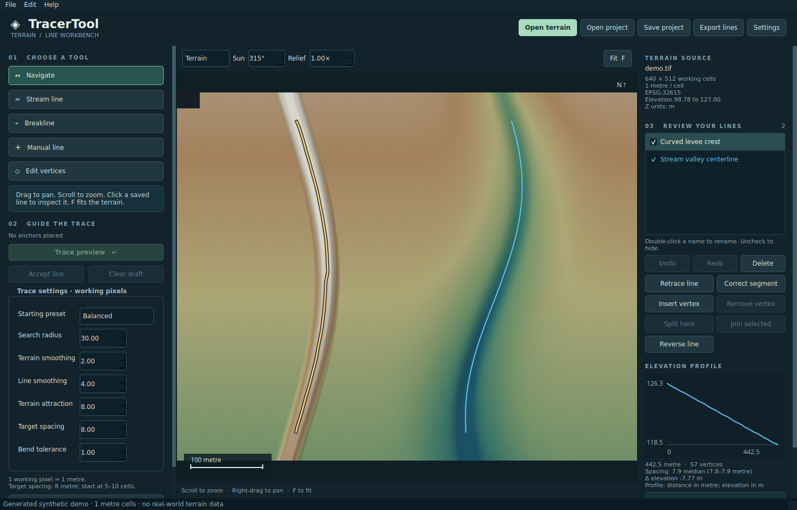

# TracerTool

A local desktop workbench for drawing stream centerlines and terrain breaklines
with fewer clicks. Open a GeoTIFF, inspect elevation and hillshade, place a few
anchors, review a terrain-guided path, edit the result, and export 3D shapefiles.
The application is independent of ArcGIS and uses Python, PySide6, Rasterio,
SciPy and scikit-image. Original code and documentation are MIT licensed.

**Status: v0.2.0 local desktop build.** The complete workflow covers terrain
viewing, assisted tracing, hand corrections, local retracing, recovery, project
saves and GIS export. Linux desktop checks, Windows executable checks under
Wine, and Windows/Linux GitHub tests are recorded separately in
[VALIDATION.md](docs/VALIDATION.md). Interactive Windows, target-GIS and operator
accuracy acceptance remain outstanding; the
release does not claim survey accuracy or automatic hydrologic correctness.

**AI development disclosure:** the initial code, tests and documentation were
substantially generated and revised with OpenAI Codex under human direction.
Independent human code and terrain-accuracy audits have not been completed.
Read the [full disclosure](AI_DISCLOSURE.md) for scope and verification limits.



The image uses entirely synthetic terrain generated by the included demo
script. It contains no private reference data and is not an accuracy benchmark.

## Run

This public snapshot provides source code. Public binary downloads have not
been released; see [publication status and gates](docs/PUBLISHING.md).

For a portable Windows build, extract the entire ZIP and open
`TracerTool/TracerTool.exe`. Keep the accompanying `_internal` folder beside
the executable. Save terrain and project files in your normal work folders.
The portable bundle includes Python and its libraries. The following commands
are for running or developing from source.

Linux source checkout:

```sh
python3 -m venv .venv
.venv/bin/python -m pip install -e '.[dev]'
.venv/bin/python -m tracertool
```

Windows PowerShell source checkout:

```powershell
py -3.13 -m venv .venv
.venv\Scripts\python -m pip install -c scripts/windows-build-constraints.txt -e ".[dev]"
.venv\Scripts\python -m tracertool
```

Use Python 3.11 or later. From an installed checkout, `python scripts/run.py`
also launches it. An optional TIFF or project path opens that file at startup.
For a reproducible example, run the following using the installed environment
(`.venv/bin/python` on Linux or `.venv\Scripts\python` on Windows):

```sh
python scripts/create_demo.py --output artifacts/demo
python -m tracertool artifacts/demo/demo.tracer.json
```

The demo generates its own terrain and project. Public tests need no private
datasets. See [installation and packaging](docs/BUILDING.md) for platform
dependencies and [data and examples](docs/INPUTS.md) for input requirements.

## Workflow

1. **Open terrain** and inspect the map, resolution and units.
2. Choose **Stream line**, **Breakline** (ridge crest or slope break), or manual
   tracing. Place anchors along the feature you intend.
3. **Trace preview**, inspect the path/profile, tune if needed, then
   **Accept line**. Drag, insert or remove vertices, retrace a poor segment,
   split/join lines, or reload a whole line's guide points for another preview.
4. Save a project, or export shapefiles for your GIS workflow.

Use **Settings** for display palettes/ranges, illumination, contours, snapping,
recovery, working resolution and export options. **Recover work** restores
local snapshots, including unfinished drafts. Explicit saves retain the
previous valid project as a `.bak` file.

Defaults scale with raster cells: 30-cell search corridor, 2-cell terrain
smoothing, 4-cell line smoothing, terrain weight 8, 8-cell target arc-length
spacing and 1-cell bend tolerance. Start at 5–10 cells between output vertices;
on the supplied native one-foot inputs those distances are feet. Guides remain
fixed, and important bends or obstacles can require shorter edges. The review
panel reports actual minimum/median/maximum spacing.

## Implemented scope and future work

| Capability | v0.2.0 scope |
|---|---|
| Terrain viewing | Single-band TIFF; elevation colors, hillshade, slope and elevation views; display palettes/stretch/gamma, multidirectional shade, contours, pan/zoom and CRS metadata. |
| Assisted lines | Anchor-guided stream, ridge crest and slope-break candidates; bounded line smoothing, fresh arc-length sampling, levee preset, manual lines and preview before acceptance. |
| Editing | Drag/insert/delete vertices; full retrace and local segment correction; split/join/reverse; snapping, undo/redo, profiles and geometry diagnostics. |
| Persistence | Versioned JSON, previous-save backup, local recovery including drafts, source fingerprints and settings/view restoration. |
| Shapefile delivery | PolyLineZ with projection and sidecars; automated read-back checks. Target-GIS manual acceptance remains required. |
| Portable Windows | Actual x64 PE executable and portable ZIP built with Windows Python/PyInstaller; frozen smoke and source Qt tests pass under Wine. Clean Windows acceptance remains required. |
| Coordinate conversion | Create a separate reprojected terrain TIFF; optional projected export CRS and explicit Z multiplier. No vertical datum conversion. |
| Full hydrologic network | Future: conditioning, flow accumulation, channel-head detection and connected network topology. |
| Large-area GIS | Future: tiled full-resolution analysis, mosaics, reference vector layers and GeoPackage. |
| Production accuracy | Future: operator-labeled benchmark, independent spatial validation and measured productivity improvement. |

The editor retains source elevations, rejects NoData crossings, and keeps
display exaggeration separate from exported geometry. Larger inputs may use a
disclosed reduced working grid. Geographic/missing CRS is viewable but not
traceable; rotated/sheared grids are currently unsupported. Source vertical
units and datum are not silently converted.

## Documentation

- [User guide and parameter tuning](docs/USER_GUIDE.md)
- [Literature, algorithm comparisons and design rationale](docs/RESEARCH.md)
- [Levee line-quality comparison and spacing decisions](docs/LINE_QUALITY_REVIEW.md)
- [Phased roadmap, parallel work, review and release gates](docs/ROADMAP.md)
- [Building, tests and Windows portability](docs/BUILDING.md)
- [Terrain data and reproducible examples](docs/INPUTS.md)
- [Measured validation and remaining acceptance work](docs/VALIDATION.md)
- [Full interaction acceptance checklist](docs/INTERACTION_QA.md)
- [Windows build provenance and compatibility-layer checks](docs/WINDOWS_BUILD.md)
- [Internal module contracts](docs/INTERFACES.md)
- [Changelog](CHANGELOG.md)
- [AI development disclosure](AI_DISCLOSURE.md)
- [Contributing and testing](CONTRIBUTING.md)
- [Security reporting](SECURITY.md)
- [Third-party components and distribution notes](THIRD_PARTY_NOTICES.md)
- [GitHub publication and release checklist](docs/PUBLISHING.md)

Bug reports should include a small shareable reproduction, version, platform,
parameters and expected behavior. Do not attach employer terrain, private
projects or location-bearing screenshots without permission. The repository's
issue and pull-request templates capture the relevant details.

Run `python -m pytest -q` for automated tests and
`python -m tracertool --smoke-test` for a desktop startup check. Build a native
portable folder with `python scripts/build_portable.py` on the target OS.

Do not upload or redistribute the supplied terrain without permission from its
owner. The MIT license covers TracerTool's original code; bundled libraries keep
their own licenses. See [LICENSE](LICENSE) and the build guide for scope.
